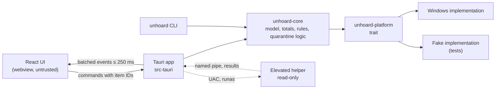

[Unhoard](../README.md) › [Docs](README.md) › Engineering › Architecture

# Architecture

How the pieces of Unhoard fit together: a Rust core that decides, a platform layer that
talks to Windows, a Tauri app that exposes a small command surface, a React UI that only
renders, a CLI, and a short-lived read-only elevated helper.

## Overview



## Layers

Layers point inwards, with no cycles.

| Layer | Where | Contents |
|---|---|---|
| `core` | `crates/core` (`unhoard-core`) | The tree arena, sizes and totals, categories, the known-locations matcher, risk tiers, quarantine and purge logic, photo grouping. Platform-neutral, no real I/O |
| `platform` | `crates/platform` (`unhoard-platform`) | A trait for everything that touches the OS, with the Windows implementation and a fake for tests |
| `app` | `src-tauri/` | Tauri commands, events and state, plus the elevated helper entry |
| `ui` | `src/` | React. It renders and never decides safety |
| `cli` | `crates/cli` (binary `unhoard`) | The command-line tool, on the same core |

Only the Windows FFI module in `unhoard-platform` may use `unsafe`. Every other crate has
`#![forbid(unsafe_code)]`.

### Repository layout

```text
crates/
  core/          unhoard-core
  platform/      unhoard-platform (trait, windows/, fake/)
  cli/           unhoard binary
src-tauri/       Tauri app, capabilities/, helper entry
src/
  app/           shell, routing, stores
  features/      storage-map, suggestions, quarantine, cloud, photos, companion, settings
  i18n/          en.json, nl.json
data/
  known-locations/*.toml
packaging/
  winget/        winget manifest (prepared, not submitted)
docs/
```

## The platform layer

The trait covers:

- directory enumeration with sizes, attributes, file IDs and reparse tags
- opening items without following reparse points, the identity check, and rename by
  handle
- cloud attributes, `CfGetPlaceholderInfo` and `CfSetPinState`
- shell thumbnails and the property store
- volume information, free space and the Recycle Bin size
- Known Folders and the sync-root list
- privileges for the elevated helper

The **fake** implementation simulates all of this in memory: attributes, placeholders,
locked files, access denied, vanishing files, a full disk and a clock. It records every
open, so a test can prove that no placeholder was opened for data (T-6.2).

## Scanning

- **Enumeration:** `NtQueryDirectoryFile(Ex)` with `FileIdFullDirectoryInformation`
  returns, per entry and in batches: `EndOfFile` (logical size), `AllocationSize` (size on
  disk), attributes, the `FileId` and the reparse tag (in `EaSize`).
- **Fallback:** `FindFirstFileExW` with `FindExInfoBasic` and `FIND_FIRST_EX_LARGE_FETCH`.
- **Parallelism:** a work-stealing pool (rayon), one task per folder, with a fixed number
  of workers and cancellation checked between batches.
- **Hard links** are counted once, keyed on `(volume serial, FileId)`.
- **Reparse points:** `IO_REPARSE_TAG_MOUNT_POINT` (junctions) and `IO_REPARSE_TAG_SYMLINK`
  are recorded but never followed. Cloud reparse tags **are** traversed, because a sync
  root is made of them.
- **Errors** are kept per folder with the path and a reason ("unscanned") and never stop
  the scan.
- Scanning is read-only: it never changes a file, a timestamp or an attribute (T-S2).

### Memory budget

Each entry in the tree arena holds: a parent index, a first-child and next-sibling index,
a name offset into a shared string buffer, two sizes, a file count, attributes, a
category and a rule ID. The budget is about **250 bytes per entry on average, names
included**, so 1 million entries stay below the 400 MB peak in
[MVP scope](05-mvp-scope.md#non-functional-requirements). The build checks this on a
generated tree of at least 1 million entries and records the numbers.

## IPC

- The UI never receives the whole tree. It asks the core for a **view**: a node ID, a
  depth, and the top N children plus "others".
- Scan progress arrives as batched events at most every 250 ms.
- **Commands are validated in Rust.** Every argument has a type and limits. Commands that
  move, restore, purge or free up space take **scan-index item IDs**, never path strings.
  Rust resolves the ID, checks it is not stale, and re-verifies the item on disk before
  acting (T-5.16).
- Errors return a typed code plus a message key, so the UI can show "what to do next"
  without internals.

## The elevated helper

The "Reveal hidden space" rescan needs admin. The main app never runs elevated (S7).

- The app starts the same executable with a helper argument through `ShellExecuteW` with
  the `runas` verb, which shows the UAC prompt.
- The helper enables `SeBackupPrivilege` and opens folders with
  `FILE_FLAG_BACKUP_SEMANTICS`, which lets it read the listings of folders the user may
  not.
- It scans only the folders the app passes (the unscanned ones plus System Volume
  Information), each checked against an allowlist of volume roots.
- It is **read-only**: it has no command that moves, changes or deletes anything.
- It returns its results over a named pipe that only the calling user's process can open,
  and exits when done.

## Quarantine operations

All logic is in `unhoard-core`, and all file calls go through the platform trait:

1. dry run → preview (no writes)
2. per item: open without following reparse points → identity check → write and flush the
   manifest entry → rename by handle → update the entry → append to the activity log
3. at start-up: reconcile entries left in `moving`
4. the purge: only inside a quarantine root, only on items whose manifest entry matches,
   links removed as links

See [Cleanup and safety](11-cleanup-safety.md#the-quarantine).

## Storage on the PC

| What | Where |
|---|---|
| Settings | `%APPDATA%\Unhoard\settings.json` |
| Quarantine index, activity log, caches | `%LOCALAPPDATA%\Unhoard\` |
| Quarantine batches and manifests | `X:\Unhoard Quarantine\` per drive, and `Unhoard Quarantine` inside each sync root |

Scan results stay in memory unless the user exports them (S9).

## Security of the shell

- Tauri capabilities in `src-tauri/capabilities/` grant the window only Unhoard's own
  commands.
- No HTTP plugin and no HTTP client in the dependency tree (T-S8).
- A strict Content Security Policy, and no remote content.
- No `fs` or `shell` plugin scope beyond what a documented feature needs.

The full analysis is in the [Threat model](32-threat-model.md).

---

## Related in this cluster

- [Tech stack](21-tech-stack.md): the libraries behind each layer.
- [Development](22-development.md): how to build and test this.
- [Decisions](24-decisions.md): why it is built this way.
- [Translations](23-translations.md): how text reaches the UI.

Back to the [docs hub](README.md).
