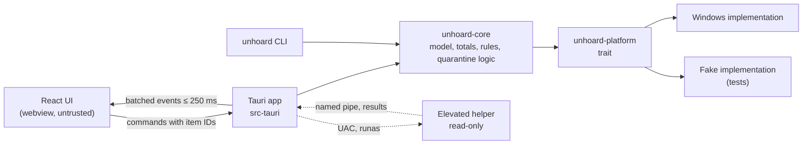

[Unhoard](../README.md) › [Docs](README.md) › Engineering › Architecture

# Architecture

How the pieces of Unhoard fit together: a Rust core that decides, a platform layer that
talks to Windows, a Tauri app that exposes a small command surface, a React UI that only
renders, a CLI, and a short-lived read-only elevated helper.

## Overview



## Layers

Layers point inwards, with no cycles.

| Layer | Where | Contents |
|---|---|---|
| `core` | `crates/core` (`unhoard-core`) | The tree arena, sizes and totals, categories, the known-locations matcher, risk tiers, quarantine and purge logic, photo grouping, view queries, and the `FileSystem` trait with an in-memory fake (feature `fake`) for tests. Platform-neutral, no real I/O |
| `platform` | `crates/platform` (`unhoard-platform`) | The Windows implementation of the `FileSystem` trait, plus well-known locations, sync roots, thumbnails, media properties and the elevated helper |
| `app` | `src-tauri/` | Tauri commands, events and state, plus the elevated helper entry |
| `ui` | `src/` | React. It renders and never decides safety |
| `cli` | `crates/cli` (binary `unhoard`) | The command-line tool, on the same core |

Only the Windows FFI module in `unhoard-platform` may use `unsafe`. Every other crate has
`#![forbid(unsafe_code)]`.

### Repository layout

```text
crates/
  core/          unhoard-core
  platform/      unhoard-platform (WindowsFs, system, media, reveal, win/ FFI)
  cli/           unhoard binary
src-tauri/       Tauri app, capabilities/, helper entry
src/
  api/           typed command calls and types
  map/           power-diagram layout, treemap, morph, canvas renderer
  components/    stage, side panels, preview, photo grid, companion
  screens/       suggestions, quarantine, cloud, photos, settings
  companion/     bubble queue and triggers
  i18n/          en.json, nl.json
  dev/           fake core for browser runs and the performance scenarios
perf/            performance scenarios, budgets and baseline
scripts/         docs check
data/
  known-locations/*.toml
packaging/
  winget/        winget manifest (prepared, not submitted)
docs/
```

## The platform layer

The core defines the `FileSystem` trait (`crates/core/src/fs.rs`); the platform layer
implements it for Windows. The trait covers:

- directory enumeration with sizes, attributes, file IDs and reparse tags
- opening items without following reparse points, the identity check, and rename by
  handle
- delete through a verified handle, durable writes, small reads and appends
- the placeholder in-sync state (`CfGetPlaceholderInfo`) and the pin state (`attrib -p +u`)
- volume information and free space

Outside the trait, the platform layer reads the environment, the Downloads Known Folder
and the sync roots (`system.rs`), shell thumbnails and the property store (`media.rs`)
and runs the elevated helper (`reveal.rs`). All `unsafe` code sits in its private `win`
module.

The **fake** (`unhoard-core`, feature `fake`) simulates all of this in memory: attributes, placeholders,
locked files, access denied, vanishing files, a full disk and a clock. It records every
open, so a test can prove that no placeholder was opened for data (T-6.2).

## Scanning

- **Enumeration:** `GetFileInformationByHandleEx` with `FileIdExtdDirectoryInfo` returns,
  per entry and in batches of 64 KiB: `EndOfFile` (logical size), `AllocationSize` (size
  on disk), attributes, the 128-bit file ID and the reparse tag.
- **Fallback:** `FileIdBothDirectoryInfo` (64-bit file IDs) on FAT and exFAT.
- **Parallelism:** a work-stealing pool (rayon), one task per folder, with a fixed number
  of workers and cancellation checked between batches.
- **Hard links** are counted once, keyed on `(volume serial, FileId)`.
- **Reparse points:** `IO_REPARSE_TAG_MOUNT_POINT` (junctions) and `IO_REPARSE_TAG_SYMLINK`
  are recorded but never followed. Cloud reparse tags **are** traversed, because a sync
  root is made of them.
- **Errors** are kept per folder with the path and a reason ("unscanned") and never stop
  the scan.
- Scanning is read-only: it never changes a file, a timestamp or an attribute (T-S2).

### Memory budget

Each entry in the tree arena holds its name, a parent, first-child and next-sibling
index, two sizes, a file count, attributes, the 128-bit file ID, the last-write time, a
category, a rule ID and flags. A folder also keeps its bytes per category for the colour
mix, and a set of file IDs counts hard links once. The budget is about **250 bytes per
entry on average, names included**, so 1 million entries stay below the 400 MB peak in
[MVP scope](05-mvp-scope.md#non-functional-requirements). To check it, run
`cargo run --release -p unhoard-core --example memory -- 1000000`: it builds a generated
tree with realistic name lengths and holds it for three seconds, so the peak working set
can be read in Task Manager or with `Get-Process`.

## IPC

- The UI never receives the whole tree. It asks the core for a **view**: a node ID, a
  depth, and the top N children plus "others".
- Scan progress arrives as batched events at most every 250 ms.
- **Commands are validated in Rust.** Every argument has a type and limits. Commands that
  move, restore, purge or free up space take **scan-index item IDs**, never path strings.
  Rust resolves the ID, checks it is not stale, and re-verifies the item on disk before
  acting (T-5.16).
- Errors return a typed code plus a message key, so the UI can show "what to do next"
  without internals.

## The elevated helper

The "Reveal hidden space" rescan needs admin. The main app never runs elevated (S7).

- The app starts the same executable with a helper argument and a random pipe name
  through `ShellExecuteExW` with the `runas` verb, which shows the UAC prompt.
- The helper connects to the local-only pipe. The app accepts the connection only from
  the process ID of the helper it started, then sends the folders to read: the unscanned
  ones, plus System Volume Information for "Reveal hidden space". Because the list goes
  over the pipe, the helper can start when a scan starts and get its list when the scan
  ends.
- The helper validates every folder (an absolute local path without `.` or `..`
  components, at most 4,096 folders), enables `SeBackupPrivilege`, and scans them with
  `FILE_FLAG_BACKUP_SEMANTICS`, which lets it read listings the user may not.
- It is **read-only**: it has no command that moves, changes or deletes anything. It
  sends its results back over the same pipe and exits.
- The app fills the scanned tree with the results. Those items are marked "read with
  admin rights" and offer no move.

## Local tools

App adapters may run a tool the user has installed, such as `docker system df`, or open
the app itself (Docker Desktop, Ollama, or Steam through its `steam://` link):

- only after a click, never during a scan
- from the app's fixed install folder (for Docker, `%LOCALAPPDATA%\Programs\DockerDesktop`
  or `%ProgramFiles%\Docker\Docker`), never from a path found by the scan, the registry
  or `PATH`
- with fixed, read-only arguments and no shell, so nothing the user or a file name
  supplies reaches the command line
- with a 15-second time limit, a 64 KiB output limit and no console window; the output
  is parsed as untrusted data

## Quarantine operations

All logic is in `unhoard-core`, and all file calls go through the platform trait:

1. dry run → preview (no writes)
2. per item: open without following reparse points → identity check → write and flush the
   manifest entry → rename by handle → update the entry → append to the activity log
3. at start-up: reconcile entries left in `moving`
4. the purge: only inside a quarantine root, only on items whose manifest entry matches,
   links removed as links

See [Cleanup and safety](11-cleanup-safety.md#the-quarantine).

## Storage on the PC

| What | Where |
|---|---|
| Settings | `%APPDATA%\Unhoard\settings.json` |
| Activity log | `%LOCALAPPDATA%\Unhoard\activity.jsonl` |
| Quarantine batches and manifests | `X:\Unhoard Quarantine\` per drive, and `Unhoard Quarantine` inside each sync root |

Scan results stay in memory unless the user exports them (S9). The quarantine view is
rebuilt from the manifests in the quarantine roots at every start; there is no separate
index file.

## Security of the shell

- Tauri capabilities in `src-tauri/capabilities/` grant the window only Unhoard's own
  commands.
- No HTTP plugin and no HTTP client in the dependency tree (T-S8).
- A strict Content Security Policy, and no remote content.
- No `fs` or `shell` plugin scope beyond what a documented feature needs.

The full analysis is in the [Threat model](32-threat-model.md).

---

## Related in this cluster

- [Tech stack](21-tech-stack.md): the libraries behind each layer.
- [Development](22-development.md): how to build and test this.
- [Decisions](24-decisions.md): why it is built this way.
- [Translations](23-translations.md): how text reaches the UI.

Back to the [docs hub](README.md).
